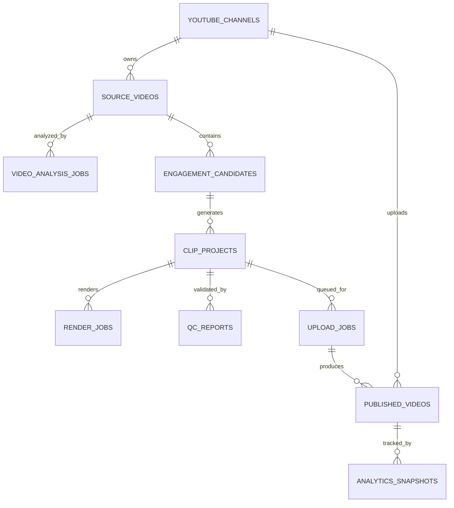

# Database Schema Specification

The application uses SQLite with Write-Ahead Logging (`PRAGMA journal_mode=WAL;`) and foreign key enforcement (`PRAGMA foreign_keys=ON;`). This schema can seamlessly migrate to PostgreSQL / Supabase if distributed deployment is requested.

## Entity Relationship Overview

---

## Table Definitions

### 1. `youtube_channels`
- `id` (VARCHAR(64), Primary Key): Internal channel identifier (UUID).
- `channel_id` (VARCHAR(128), Unique, Indexed): YouTube Channel ID (e.g. `UC...`).
- `title` (VARCHAR(255), Not Null): Channel display name.
- `custom_url` (VARCHAR(128), Nullable): Channel custom handle.
- `thumbnail_url` (TEXT, Nullable): Channel avatar URL.
- `subscriber_count` (INTEGER, Default 0): Total subscribers.
- `video_count` (INTEGER, Default 0): Total public videos.
- `encrypted_credentials` (TEXT, Nullable): Fernet AES-encrypted OAuth tokens (`refresh_token`, `access_token`, `expiry`).
- `token_expiry` (DATETIME, Nullable): Access token expiration timestamp.
- `is_authorized` (BOOLEAN, Default FALSE): OAuth authorization status.
- `created_at` (DATETIME, Default CURRENT_TIMESTAMP).
- `updated_at` (DATETIME, Default CURRENT_TIMESTAMP).

### 2. `source_videos`
- `id` (VARCHAR(64), Primary Key): UUID.
- `channel_id` (VARCHAR(64), Foreign Key -> `youtube_channels.id`, Nullable): Associated channel if imported.
- `youtube_video_id` (VARCHAR(32), Nullable, Indexed): External YouTube ID if applicable.
- `title` (VARCHAR(500), Not Null): Video title.
- `description` (TEXT, Nullable): Video description.
- `file_path` (VARCHAR(1024), Not Null): Absolute path to original video file on disk.
- `proxy_path` (VARCHAR(1024), Nullable): Low-resolution 360p analysis proxy path.
- `audio_path` (VARCHAR(1024), Nullable): Extracted WAV audio path.
- `duration_seconds` (FLOAT, Not Null): Total duration in seconds.
- `width` (INTEGER, Not Null): Horizontal resolution in pixels.
- `height` (INTEGER, Not Null): Vertical resolution in pixels.
- `fps` (FLOAT, Not Null): Frame rate.
- `codec_video` (VARCHAR(32), Nullable): e.g. `h264`, `hevc`.
- `codec_audio` (VARCHAR(32), Nullable): e.g. `aac`, `opus`.
- `source_status` (VARCHAR(32), Default 'owned'): `owned`, `licensed`, `authorized`, `unknown`, `restricted`.
- `analysis_status` (VARCHAR(32), Default 'pending'): `pending`, `analyzing`, `completed`, `failed`.
- `created_at` (DATETIME, Default CURRENT_TIMESTAMP).
- `updated_at` (DATETIME, Default CURRENT_TIMESTAMP).

### 3. `video_analysis_jobs`
- `id` (VARCHAR(64), Primary Key): UUID.
- `source_video_id` (VARCHAR(64), Foreign Key -> `source_videos.id`, Not Null).
- `status` (VARCHAR(32), Default 'queued'): `queued`, `processing`, `completed`, `failed`, `cancelled`.
- `current_step` (VARCHAR(64), Nullable): e.g. `audio_extract`, `transcribe`, `scene_detect`, `visual_activity`.
- `progress_percent` (FLOAT, Default 0.0): 0 to 100.
- `raw_analysis_json` (TEXT, Nullable): Full serialized multi-modal analysis payload.
- `error_message` (TEXT, Nullable): Failure details.
- `started_at` (DATETIME, Nullable).
- `completed_at` (DATETIME, Nullable).
- `created_at` (DATETIME, Default CURRENT_TIMESTAMP).

### 4. `transcripts`
- `id` (VARCHAR(64), Primary Key): UUID.
- `source_video_id` (VARCHAR(64), Foreign Key -> `source_videos.id`, Not Null, Unique).
- `language` (VARCHAR(16), Default 'en'): Detected language.
- `text_full` (TEXT, Not Null): Complete raw transcript text.
- `words_json` (TEXT, Not Null): JSON array of words with `{word, start, end, confidence}`.
- `sentences_json` (TEXT, Not Null): JSON array of segmented sentences with `{text, start, end}`.
- `created_at` (DATETIME, Default CURRENT_TIMESTAMP).

### 5. `scene_segments`
- `id` (VARCHAR(64), Primary Key): UUID.
- `source_video_id` (VARCHAR(64), Foreign Key -> `source_videos.id`, Not Null).
- `start_time` (FLOAT, Not Null): Scene start in seconds.
- `end_time` (FLOAT, Not Null): Scene end in seconds.
- `duration` (FLOAT, Not Null): Scene duration.
- `visual_activity_score` (FLOAT, Default 0.0): Motion / activity metric (0-1).
- `created_at` (DATETIME, Default CURRENT_TIMESTAMP).

### 6. `engagement_candidates`
- `id` (VARCHAR(64), Primary Key): UUID.
- `source_video_id` (VARCHAR(64), Foreign Key -> `source_videos.id`, Not Null).
- `start_time` (FLOAT, Not Null): Candidate clip start timestamp.
- `end_time` (FLOAT, Not Null): Candidate clip end timestamp.
- `duration` (FLOAT, Not Null): Duration (15-60s).
- `overall_score` (FLOAT, Not Null): Engagement Opportunity Score (0-100).
- `scoring_mode` (VARCHAR(32), Not Null): `ACTUAL_ANALYTICS` or `PREDICTED`.
- `confidence` (FLOAT, Not Null): Scoring confidence (0-1).
- `hook_score` (FLOAT, Default 0.0): Hook strength component.
- `payoff_score` (FLOAT, Default 0.0): Payoff / conclusion quality.
- `emotional_score` (FLOAT, Default 0.0): Vocal / transcript emotional intensity.
- `topic_score` (FLOAT, Default 0.0): Topic importance.
- `visual_score` (FLOAT, Default 0.0): Visual activity metric.
- `retention_signal_score` (FLOAT, Nullable): Normalized actual retention score if available.
- `reasons_json` (TEXT, Nullable): Human-readable explanation array.
- `created_at` (DATETIME, Default CURRENT_TIMESTAMP).

### 7. `clip_projects`
- `id` (VARCHAR(64), Primary Key): UUID.
- `candidate_id` (VARCHAR(64), Foreign Key -> `engagement_candidates.id`, Nullable).
- `source_video_id` (VARCHAR(64), Foreign Key -> `source_videos.id`, Not Null).
- `title` (VARCHAR(255), Not Null): Working project title.
- `start_time` (FLOAT, Not Null): Exact clip start.
- `end_time` (FLOAT, Not Null): Exact clip end.
- `caption_style` (VARCHAR(64), Default 'bold_yellow'): Subtitle template.
- `framing_mode` (VARCHAR(32), Default 'smart_face'): `smart_face`, `center_safe`, `dual_stacked`.
- `rendered_video_path` (VARCHAR(1024), Nullable): Output 9:16 MP4 path.
- `thumbnail_path` (VARCHAR(1024), Nullable): 9:16 thumbnail image path.
- `status` (VARCHAR(32), Default 'draft'): `draft`, `rendering`, `rendered`, `qc_passed`, `qc_failed`, `approved`, `scheduled`, `published`.
- `metadata_json` (TEXT, Nullable): Generated titles, description, tags, hashtags.
- `created_at` (DATETIME, Default CURRENT_TIMESTAMP).
- `updated_at` (DATETIME, Default CURRENT_TIMESTAMP).

### 8. `qc_reports`
- `id` (VARCHAR(64), Primary Key): UUID.
- `clip_project_id` (VARCHAR(64), Foreign Key -> `clip_projects.id`, Not Null).
- `passed` (BOOLEAN, Not Null): Overall pass/fail gate.
- `overall_score` (FLOAT, Not Null): 0 to 100 quality score.
- `video_checks_json` (TEXT, Not Null): Aspect ratio, black frame, corruption checks.
- `audio_checks_json` (TEXT, Not Null): Loudness, clipping, silence, sync checks.
- `caption_checks_json` (TEXT, Not Null): Subtitle boundary and timing checks.
- `framing_checks_json` (TEXT, Not Null): Subject visibility and crop stability checks.
- `repaired` (BOOLEAN, Default FALSE): Whether an auto-repair was triggered.
- `created_at` (DATETIME, Default CURRENT_TIMESTAMP).

### 9. `upload_jobs`
- `id` (VARCHAR(64), Primary Key): UUID.
- `clip_project_id` (VARCHAR(64), Foreign Key -> `clip_projects.id`, Not Null).
- `channel_id` (VARCHAR(64), Foreign Key -> `youtube_channels.id`, Not Null).
- `mode` (VARCHAR(32), Default 'SAFE'): `SAFE` (manual approve) or `AUTOMATIC` (auto publish).
- `status` (VARCHAR(32), Default 'queued'): `queued`, `uploading`, `completed`, `failed`, `cancelled`.
- `scheduled_publish_time` (DATETIME, Nullable): Target publish time.
- `privacy_status` (VARCHAR(32), Default 'private'): `private`, `unlisted`, `public`.
- `retry_count` (INTEGER, Default 0): Retries attempted.
- `error_message` (TEXT, Nullable): Error details if failed.
- `created_at` (DATETIME, Default CURRENT_TIMESTAMP).

### 10. `published_videos`
- `id` (VARCHAR(64), Primary Key): UUID.
- `clip_project_id` (VARCHAR(64), Foreign Key -> `clip_projects.id`, Not Null).
- `youtube_video_id` (VARCHAR(64), Not Null, Indexed): YouTube Short video ID.
- `channel_id` (VARCHAR(64), Foreign Key -> `youtube_channels.id`, Not Null).
- `published_at` (DATETIME, Not Null): Actual upload/publish time.
- `created_at` (DATETIME, Default CURRENT_TIMESTAMP).

### 11. `analytics_snapshots`
- `id` (VARCHAR(64), Primary Key): UUID.
- `published_video_id` (VARCHAR(64), Foreign Key -> `published_videos.id`, Not Null).
- `views` (INTEGER, Default 0).
- `watch_time_minutes` (FLOAT, Default 0.0).
- `avg_view_duration_seconds` (FLOAT, Default 0.0).
- `avg_percentage_viewed` (FLOAT, Default 0.0).
- `likes` (INTEGER, Default 0).
- `comments` (INTEGER, Default 0).
- `subscribers_gained` (INTEGER, Default 0).
- `recorded_at` (DATETIME, Default CURRENT_TIMESTAMP).

### 12. `learning_insights`
- `id` (VARCHAR(64), Primary Key): UUID.
- `channel_id` (VARCHAR(64), Foreign Key -> `youtube_channels.id`, Not Null).
- `factor_correlations_json` (TEXT, Not Null): Statistical correlation matrix.
- `recommended_weights_json` (TEXT, Not Null): Tuned weights for engagement scoring.
- `best_duration_bucket` (VARCHAR(32), Nullable): e.g. `25-35s`.
- `best_hook_type` (VARCHAR(64), Nullable): e.g. `surprising_statement`.
- `created_at` (DATETIME, Default CURRENT_TIMESTAMP).
