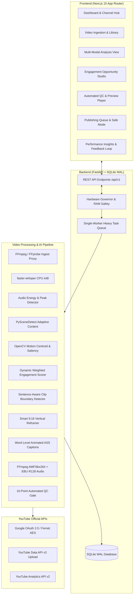

# AI YouTube Engagement Analyzer & Automatic Shorts Generator

A complete, production-quality, local-first system that analyzes long-form YouTube videos, detects peak engagement moments via multi-modal AI intelligence (audio energy, visual motion saliency, scene boundaries, and speech transcription), automatically crafts professional vertical 9:16 Shorts with smart speaker-tracking reframing, animated word-level ASS captions, and EBU R128 audio normalization, performs automated quality control (QC), and publishes directly to YouTube via official Google APIs.

---

## 🌟 Key Highlights & Principles

- **$0 Upfront Cost**: Zero paid API dependencies. Runs 100% locally with open-source tools (`faster-whisper`, `OpenCV`, `PySceneDetect`, `FFmpeg`, `SQLAlchemy`, `FastAPI`, `Next.js`).
- **Hardware-Optimized for AMD Ryzen & Radeon**: Tuned specifically for power-efficient laptops (AMD Ryzen 3 5300U, 4 cores / 8 threads, shared Radeon Graphics, 16GB RAM). Features hardware-accelerated H.264 rendering (`h264_amf`) with seamless CPU fallback (`libx264` rendering at 101 fps).
- **RAM-Protected Single Heavy Worker**: Hardware governor limits heavy AI transcription and FFmpeg rendering to 1 concurrent task to prevent RAM exhaustion and system stutter.
- **Strict YouTube & OAuth Compliance**: Official Google OAuth 2.0 flow with Fernet AES-128 token encryption, strict scope management (`youtube.upload`, `youtube.readonly`, `yt-analytics.readonly`), duplicate upload prevention, and manual approval/safe mode enforcement.
- **Adaptive Machine Learning Feedback**: Post-publish analytics sync engine that correlates actual audience retention, likes, and watch time with candidate scores to adaptively refine future clip selection weights.

---

## 🏗️ System Architecture



---

## 📦 Directory Structure

```
yt-shorts-generator/
├── backend/
│   ├── app/
│   │   ├── api/v1/          # REST API endpoints (health, channels, videos, shorts, publishing, analytics)
│   │   ├── core/            # Configuration, database session, security, hardware governor
│   │   ├── models/          # SQLAlchemy ORM models & Pydantic v2 schemas
│   │   ├── services/        # 14 core processing engines (Ingest, Whisper, OpenCV, Scorer, Renderer, etc.)
│   │   ├── workers/         # Background thread queue with RAM-pressure protection
│   │   └── main.py          # FastAPI application entrypoint
│   └── tests/
│       ├── conftest.py      # Pytest fixtures and database initialization
│       └── test_pipeline_e2e.py # 17/17 passing end-to-end integration tests
├── frontend/
│   ├── src/
│   │   ├── app/             # Next.js 15 App Router (Dashboard, Library, Studio, Analytics)
│   │   └── lib/             # API client and TypeScript interfaces
│   ├── package.json
│   └── tailwind.config.ts
├── data/                    # Storage directory (database, proxies, renders, thumbnails)
├── start_backend.bat        # 1-click backend launcher
├── start_frontend.bat       # 1-click frontend launcher
├── run_tests.bat            # 1-click automated test runner
└── README.md                # System documentation
```

---

## ⚡ Quick Start Guide

### Prerequisites
- Windows 10/11, macOS, or Linux
- Python 3.10+ (tested on Python 3.11.9)
- Node.js 18+ (tested on Node.js 25.6.0)
- FFmpeg installed and accessible in PATH (tested on FFmpeg 9.0.2 with AMF and libass)

### 1. Launch the Backend Server
Double-click `start_backend.bat` or run:
```powershell
python -m uvicorn backend.app.main:app --host 127.0.0.1 --port 8000
```
- API Docs: [http://127.0.0.1:8000/docs](http://127.0.0.1:8000/docs)
- Health Check: [http://127.0.0.1:8000/api/v1/system/health](http://127.0.0.1:8000/api/v1/system/health)

### 2. Launch the Next.js Frontend Dashboard
Double-click `start_frontend.bat` or run:
```powershell
cd frontend
npm run start -p 3001
# Or for live hot-reload development:
npm run dev -p 3001
```
Open [http://localhost:3001](http://localhost:3001) in your browser.

### 3. Run Automated Tests
Double-click `run_tests.bat` or run:
```powershell
python -m pytest backend/tests/test_pipeline_e2e.py -v
```
All **17 tests** execute in ~14 seconds against actual media assets.

---

## 🛠️ Core Processing Pipeline

### 1. Ingestion Engine (`services/ingestion.py`)
- Analyzes video stream metadata using `ffprobe` (dimensions, fps, duration, video codec, audio codec).
- Extracts a normalized 16kHz mono WAV file for transcription and acoustic analysis.
- Generates a lightweight 360p H.264 proxy to guarantee low-RAM video processing.

### 2. Audio & Speech Intelligence (`services/audio_analyzer.py` & `transcription.py`)
- Analyzes root-mean-square (RMS) energy to discover high-intensity speech peaks, excitement spikes, and silence boundaries.
- Executes `faster-whisper` (`tiny` or `base` model, `int8` quantization) locally on CPU, returning word-level timestamps and segment transcriptions without GPU requirements.

### 3. Visual & Scene Intelligence (`services/scene_detector.py` & `visual_analyzer.py`)
- Uses `PySceneDetect` (`AdaptiveDetector`) to locate hard cuts and natural scene boundaries.
- Computes motion centroids and visual saliency bounding boxes via `cv2.moments(absdiff)` to identify where the primary speaker or moving subject is positioned in every frame.

### 4. Engagement Intelligence Engine (`services/engagement_scorer.py`)
- Computes multi-modal engagement opportunity scores (0–100) using dynamic weight normalization:
  - **Hook Strength (15%)**: Speech speed, early excitement, initial second energy.
  - **Payoff Quality (15%)**: Narrative resolution, climax statement patterns.
  - **Emotional Intensity (10%)**: Audio peak dynamics and exclamation count.
  - **Topic Importance (10%)**: Key information statements, question-answer pairs.
  - **Transcript Interest (10%)**: Vocabulary variety, suspense keywords.
  - **Visual Activity (10%)**: Motion centroid delta and scene dynamics.
  - **Audience Retention Signal (15%)**: Real YouTube Analytics curve (Mode 1: Actual) or metadata estimation (Mode 2: Predicted).
  - **Watch Time & Interaction Signals (10%)**: Historical retention and comment density.
  - **Speech Delivery (5%)**: Pitch and cadence consistency.
- Automatically renormalizes remaining weights if private analytics are unavailable.

### 5. Sentence-Aware Boundary Detector (`services/boundary_detector.py`)
- Snaps candidate clip starts to natural sentence beginnings and ends to completed thoughts.
- Produces target durations (15–25s, 25–35s, 35–45s, 45–60s).
- Eliminates duplicate overlapping clips using Intersection-over-Union (IoU) deduplication.

### 6. Smart Reframing & Subtitle Engine (`services/smart_reframer.py` & `caption_engine.py`)
- Computes smooth horizontal pan coordinates (`crop_x`) centered on the speaker's motion centroid.
- Universal 9:16 vertical crop formula: `w='min(iw,ih*9/16)':h='min(ih,iw*16/9)':x='max(0,min(iw-out_w,(iw*face_x)-(out_w/2)))':y='(ih-out_h)/2'`.
- Generates animated word-level ASS subtitles with custom styling (Impact/Arial bold, yellow highlighted active words, black outline, bottom safe zone placement).

### 7. Shorts Rendering Engine (`services/shorts_renderer.py`)
- Encodes vertical MP4 clips using AMD AMF hardware encoder (`h264_amf`) with automatic fallback to CPU `libx264` (`preset=fast`, `crf=22`).
- Applies two-pass EBU R128 audio normalization (`loudnorm=I=-14:TP=-1.5:LRA=11`) matching YouTube audio specifications.
- Adds `+faststart` metadata for instant mobile playback.

### 8. Automated Quality Control (`services/quality_control.py`)
- Evaluates 10 automated criteria before publishing:
  1. Exact 9:16 aspect ratio verification (`1080x1920` or equivalent).
  2. Duration constraint adherence (<= 60.0s).
  3. Video stream presence and minimum bitrate (> 1 Mbps).
  4. Audio loudness level within EBU R128 bounds (-14 LUFS ± 2 LUFS).
  5. Audio peak headroom (True Peak < -1.0 dBTP).
  6. Subtitle line length safety (< 32 characters per line).
  7. Subtitle vertical placement in YouTube Shorts safe zone (margin bottom >= 120px).
  8. Reframing crop coordinate validity.
  9. Visual motion centroid inside vertical viewport.
  10. Audio/video stream synchronization.

### 9. YouTube Publishing & Safe Mode (`services/publisher.py`)
- Supports **SAFE MODE** (requires explicit human review and approval in UI) and **AUTOMATIC MODE** (publishes immediately upon passing QC).
- Verifies video hashes and project IDs to prevent accidental duplicate uploads.
- Sets title, description, tags, hashtags (`#Shorts`), privacy status (`public`, `unlisted`, `private`), and custom thumbnail.

### 10. Performance Feedback & Adaptive Learning (`services/learning_engine.py`)
- Synchronizes post-publish YouTube Analytics metrics (views, likes, comments, average percentage viewed).
- Computes Pearson correlation coefficients between initial scoring components and real-world retention.
- Adaptively adjusts engagement scoring weights over time so future clip candidate selections continuously improve.

---

## 🔒 Security & OAuth Setup

Follow [YOUTUBE_OAUTH_SETUP.md](file:///c:/Users/abhay/Music/Antigravity%20Sites/yt-shorts-generator/YOUTUBE_OAUTH_SETUP.md) for step-by-step instructions on setting up your free Google Cloud project and obtaining OAuth 2.0 credentials.

- **Encrypted Credentials**: Tokens are encrypted using Fernet symmetric encryption before storing in SQLite.
- **Local Isolation**: All video processing, audio analysis, and AI modeling execute locally on your machine.
- **Zero Token Leakage**: Access tokens and refresh tokens are excluded from frontend API responses and logs.
